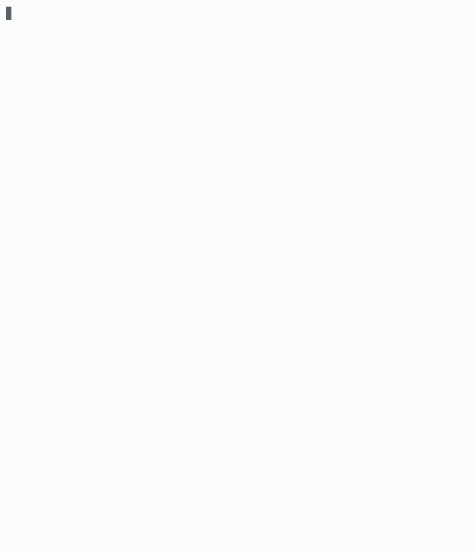
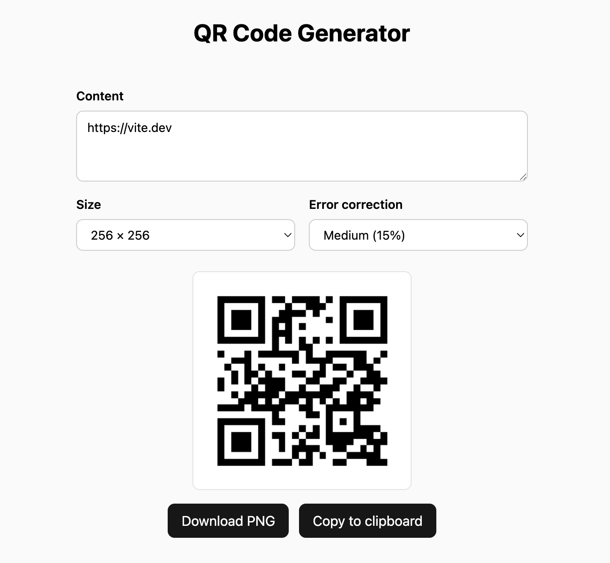

# QW (QuasarWave)

QW is a focused, local LLM inference runtime for single-user Apple Silicon
systems. It serves the Qwen3.8 27B dense checkpoint through an
OpenAI-compatible HTTP API and includes a command-line client for downloading
models, generating responses, and inspecting the local cache.

QW is intentionally narrow: MLX is the supported backend, and the default
model is
[Jundot/Qwen3.8-27B-oQ4e-fp16-mtp](https://huggingface.co/Jundot/Qwen3.8-27B-oQ4e-fp16-mtp).
It is not a general multi-model or CUDA/ROCm runtime.

QW also supports:

- MTP with included heads in the default model checkpoint
- DFlash2 speculative decoding (depends on `--features dflash2`, enabled by default)
- Image vision
- Grammar constrained decoding

## Showcase

Asciicast demo implementing a QR Code generator webapp(no speedup):


The Pi agent with QW built this QR-code app in 2m 40s:



## Install

Prebuilt binaries can be installed with the release installer:

```bash
curl --proto '=https' --tlsv1.2 -LsSf https://github.com/cr0sh/qw/releases/download/v0.1.0/qw-cli-installer.sh | sh
```

To compile from source, use macOS on Apple Silicon with the Rust toolchain,
CMake 3.16 or newer, and the Xcode Command Line Tools:

```bash
xcode-select --install
cargo install --locked --git https://github.com/cr0sh/qw qw-cli
```

To install a tagged release, add `--tag <tag>` to the `cargo install`
command.

## Quickstart

Download the default target checkpoint and the optional DFlash2 draft
checkpoint:

```bash
qw download
qw download incoai/Qwen3.8-27B-DFlash2
```

Start the local server:

```bash
qw serve
```

The server listens at `http://127.0.0.1:8000` by default. Its OpenAI-compatible
base URL is `http://127.0.0.1:8000/v1`; supported POST endpoints include
`/chat/completions` and `/responses`.

For example:

```bash
curl http://127.0.0.1:8000/v1/chat/completions \
  -H 'content-type: application/json' \
  -d '{"model":"qwen3.8-27b","messages":[{"role":"user","content":"Hello!"}],"max_tokens":64}'
```

Generate one response without starting the HTTP server:

```bash
qw generate --prompt 'Explain prefix caching in one sentence.'
```

Inspect local model and cache state, or view all command-line options:

```bash
qw stats
qw --help
qw serve --help
qw generate --help
```

## Models and decoder options

The target model can be selected by checkpoint path with `--model` or
`QW_MODEL_PATH`; when neither is set, QW resolves the default model from its
cache. The optional DFlash2 draft checkpoint can be selected with
`--dflash-draft-model` or `QW_DFLASH_DRAFT_MODEL_PATH`.

Both `qw generate` and `qw serve` expose `--decoder auto|baseline|mtp|dflash`.
The `dflash` option requires a build with the `dflash2` feature and an
available draft checkpoint. Use `--help` for the options enabled by the
current build.

## SpecPrefill

SpecPrefill is an optional sparse-prefill mode. It is off by default; build the
CLI with the feature enabled to expose it:

```bash
cargo build -p qw-cli --features specprefill
```

The draft checkpoint is `mlx-community/Qwen3.5-0.8B-MLX-8bit`. It is resolved
from the model cache at
`~/.cache/qw/models/mlx-community/Qwen3.5-0.8B-MLX-8bit`; download it with:

```bash
qw download mlx-community/Qwen3.5-0.8B-MLX-8bit
```

Override its location with `QW_SPECPREFILL_DRAFT_MODEL_PATH`. There is no
SpecPrefill draft-path CLI option. The feature build requires this draft at
startup, and validates its pinned architecture when loading it.

When built with `specprefill`, `qw serve` accepts these policy options:

- `--specprefill-min-turn-tokens` (default `8000`)
- `--specprefill-keep-rate` (default `0.25`)
- `--specprefill-keep-first-tokens` (default `256`)
- `--specprefill-keep-last-tokens` (default `256`)

The server considers SpecPrefill only on the baseline route for an eligible,
text-only, unconstrained request without a resume. Prior messages before the
current user turn or trailing tool-result group must include an assistant turn,
and their tokenized history must be an exact prefix of the prompt. That history
prefix is protected and remains dense. The current-turn threshold is strict
(`>`), so a turn exactly at the configured threshold stays dense. The eligible
suffix is also only sparse-prefilled when
its token count exceeds the configured runtime minimum. The server sets that
minimum from `--specprefill-min-turn-tokens` (default `8000`); the runtime
configuration default when used directly is `min_tokens = 8192`. Equality at
either threshold remains dense. Among eligible tokens, scoring selects chunks
according to the keep rate while forcing the configured number of initial and
final eligible tokens to remain. DFlash2 and other non-baseline routes remain dense.

## D-LSA (experimental)

D-LSA ([Distilled Latent Sparse Attention](https://github.com/Prefrontal-AI/latent-sparse-attention))
is optional sparse attention for the full-attention layers of Qwen3.8-27B. The
attention kernel is unchanged; a small learned index picks which cached keys
each query reads: the first `sink` keys, the last `window` keys, and up to
`top_k` long-range keys. Prompts short enough to read every key (up to 4,612
tokens under the defaults) run the unchanged dense attention, bit for bit.
The design and the port are documented in [`docs/dlsa.md`](docs/dlsa.md).

It is off by default and absent from default builds. Build with the feature,
download the checksum-pinned index map once, and start the server on an fp16
KV cache:

```bash
cargo build --release -p qw-cli --features dlsa
qw download --dlsa-map          # add --dlsa-pca for the training-free PCA map
qw serve --dlsa --no-kv-quantization
qw generate --dlsa --prompt "..."   # qw generate always uses an fp16 KV cache
```

| Flag | Environment | Default |
| --- | --- | --- |
| `--dlsa` | `QW_DLSA` (`1`/`true` enables, `0`/`false` leaves it off) | off |
| `--dlsa-map <PATH>` | `QW_DLSA_MAP_PATH` | the `qw download --dlsa-map` cache under `~/.cache/qw/dlsa/` |
| `--dlsa-map-kind distilled\|pca` | `QW_DLSA_MAP_KIND` | `distilled` (which cached map to use when no path is given) |
| `--dlsa-sink <N>` | `QW_DLSA_SINK` | `4` |
| `--dlsa-window <N>` | `QW_DLSA_WINDOW` | `512` (also the cluster block size; the maps were distilled at 512, other values warn) |
| `--dlsa-top-k <N>` | `QW_DLSA_TOP_K` | `4096` |
| `--dlsa-top-p <N>` | `QW_DLSA_TOP_P` | `1024` (buckets a query expands, at most 2048) |

A flag wins over its variable, which wins over the default. The map is held in
bf16. D-LSA is a property of the loaded model; there is no per-request switch.

Startup errors, each naming what to fix: a `--dlsa-*` setting without
`--dlsa` (or `QW_DLSA=1`); an invalid value (the message names the flag or
variable it came from); a missing map ("run `qw download --dlsa-map` or set
QW_DLSA_MAP_PATH"); a cached map whose sha256 differs from the pinned one;
and, for the server, D-LSA without `--no-kv-quantization`.

| Feature | Under D-LSA |
| --- | --- |
| fp16 KV (`--no-kv-quantization`) | supported, with snapshots and the prefix cache |
| int8 KV (runtime API only) | supported, without snapshots (as without D-LSA) |
| Turbo4 KV (the server default) | refused: `qw serve --dlsa` without `--no-kv-quantization` fails at startup |
| decoders `baseline`, `mtp`, `dflash`, `auto` | supported; `auto` selects as usual |
| grammar-constrained output (`json_schema`, tools) | supported |
| SpecPrefill | never used: the server logs once that it is disabled; its kept KV slots are not token positions, which the index needs |
| image inputs | refused with HTTP 400 ("image inputs are not supported while D-LSA sparse attention is enabled on this server") |

**Prefix cache.** Snapshots carry the index state next to the KV cache, so the
memory and filesystem tiers work under D-LSA as they do without it (the index
adds about 1% to an fp16 snapshot). The cache namespace includes a D-LSA
identity (the map file's sha256, map dtype, index settings and short-context
policy), so snapshots from a dense server, or from one with other D-LSA
settings, are never restored; dense namespaces are unchanged by the feature.

At startup the server logs one `D-LSA armed` line (`phase="server.dlsa"`) with
the map path, its sha256, kind, dtype and the index settings; each request logs
`phase="dlsa.request"` at debug level with the index counters and bytes.

D-LSA is currently slower than dense attention: the selection runs on the host
and the sparse read is not a fused kernel yet. Measured costs are in
[`docs/dlsa.md`](docs/dlsa.md) §12.6 and §13.

## Historical performance

Latest complete `cargo bench` results (tokens/s), with the implementation at
[commit `7894f5d`](https://github.com/cr0sh/qw/commit/7894f5d7cd5f34096fc1bb544f5124920a6c923d):

| Context                    | Target prefill | DFlash2 decode |
| -------------------------- | -------------: | -------------: |
| Fresh                      |        253.955 |         55.936 |
| 10,337-token cached prefix |        232.401 |         54.412 |
| 64,297-token cached prefix |        154.698 |         36.252 |

Fresh prefill processes 4,341 prompt tokens; cached-prefix prefill processes
only the 288 newly appended tokens, not the cached prefix. Decode excludes
prefill and measures 127 output tokens after the first token.

Earlier bundled-MTP (k=3) decode results at
[commit `117fecb`](https://github.com/cr0sh/qw/commit/117fecbc3c0f1be69a44c7bfe274f5f81d7ab24c)
were 57.354, 52.639, and 34.853 tokens/s for fresh, 10k, and 64k respectively;
these are historical measurements, not a same-revision decoder comparison.

Both runs used the default
[Jundot/Qwen3.8-27B-oQ4e-fp16-mtp](https://huggingface.co/Jundot/Qwen3.8-27B-oQ4e-fp16-mtp)
checkpoint with Turbo4 KV cache on a Mac Studio with an Apple M4 Max
40-core GPU and 64 GB of unified memory.

## Development

Cache layout, GPU serialization, and benchmark commands are collected in
[`DEVELOPMENT.md`](DEVELOPMENT.md). When running GPU work from more than one
worktree, always invoke it through `./gpu-lock -- ...`; do not delete the
shared lock file.

## Evaluation

Qwen3.8-27B (medium reasoning) achieved **43.3% Pass@1** on τ³-Banking (**42/97
tasks**, one trial per task), compared with **47.4%** reported by Artificial
Analysis as an average over five runs. Our single-run result may be affected by
sampling variability. The evaluation took approximately 26 hours on a single
M4 Max machine, so we did not run additional trials.

The τ³ banking evaluation launch and capture rules are documented in
[`eval/README.md`](eval/README.md).

## Acknowledgements

This repository is heavily AI-assisted. Commit messages include an
`Assisted-by` footer identifying the coding agent/model used.

QW is inspired by antirez's [ds4](https://github.com/antirez/ds4) inference
engine for its minimalism and simplicity.

The repository started from a stripped version of `mlxcel-core` from
[mlxcel](https://github.com/lablup/mlxcel). We appreciate
[Lablup](https://lablup.com/)'s open-source contributions.

QW adopts optimization approaches from [oMLX](https://github.com/Jundot/oMLX),
[ds4](https://github.com/antirez/ds4), and
[qwen-3.8-mtp-challenge](https://github.com/Layr-Labs/qwen-3.8-mtp-challenge).
Derivative work is attributed in the relevant commit messages.
